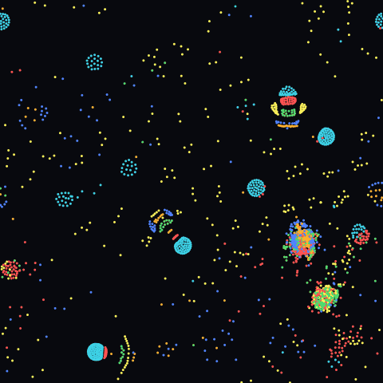
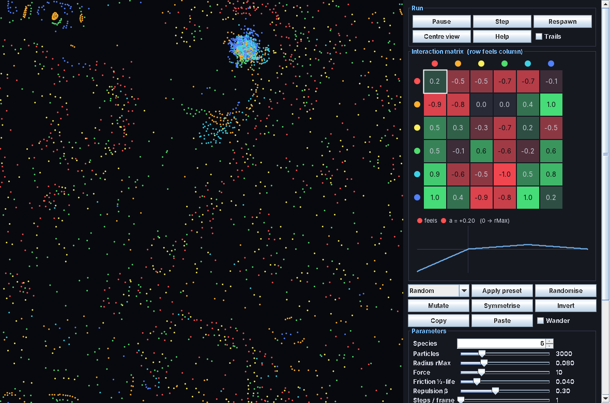
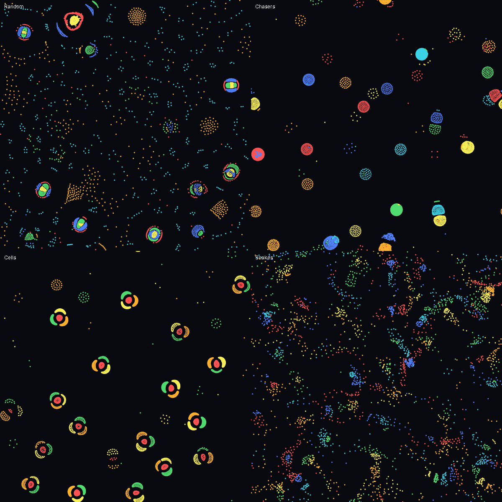

# Particle Life Lab



**Particle Life Lab** is a single-file Java Swing laboratory for *Particle Life*. In this artificial-life toy, a few species of coloured dots attract and repel one another according to a small table of numbers. Nothing else is programmed in. Even so, you get cells with membranes, writhing worms, predators chasing prey and little rotating machines.

It is part of a series of artificial-life labs, alongside Tierra Lab, Lenia Lab, Flow Lenia Lab, Gray–Scott Lab and Primordial Soup Lab.

## Running it

You need Java 17 or later. No libraries, no build step:

```
java ParticleLifeLab.java
```

To run a short headless self-test, which steps through every preset and reports timings and statistics:

```
java ParticleLifeLab.java --selftest
```



## The idea

Every particle belongs to a species: up to eight of them, each with its own colour. Each particle looks at all its neighbours within a radius *rMax* and is pushed or pulled by them:

- **Very close up, everything repels.** Below a fraction β of *rMax*, particles push apart, so they never collapse onto one another.
- **Further out, the matrix decides.** Between β and *rMax*, species *i* feels species *j* with a strength *a*[*i*][*j*] between −1 (repel) and +1 (attract). The force rises to a peak half-way out and then falls back to zero.
- **Friction** bleeds away velocity, so the system settles unless something keeps driving it.
- **The world is a torus.** Particles leaving one edge reappear on the opposite side, though you can switch to walls.

The crucial ingredient is that the matrix **need not be symmetric**. Red can be drawn to blue while blue flees from red. That breaks Newton's third law: forces no longer come in equal and opposite pairs, so momentum isn't conserved and the system can keep moving forever. Make the matrix symmetric and the motion dies away within moments, leaving a frozen crystal. Make it asymmetric and you get life-like behaviour.

## What the lab offers

**Interaction matrix editor.** The coloured grid shows the whole rule set: green means attraction, red means repulsion. The row is the species that feels the force; the column is the species it reacts to.

| Action | Effect |
|---|---|
| Left-click / scroll up | +0.1 (Shift: +0.5) |
| Right-click / scroll down | −0.1 (Shift: −0.5) |
| Middle-click | set to zero |

Below the grid, a small graph plots the force law for the selected cell against distance, so you can see exactly what you are changing.

**Presets.**

| Preset | What tends to happen |
|---|---|
| Random | Anything at all. Press it repeatedly and you'll soon find creatures. |
| Random symmetric | A random matrix forced to be symmetric. Watch it settle and freeze. |
| Snakes | Each species chases the next. Long sinuous filaments that writhe and coil. |
| Chains | Stable linked chains and lattices. |
| Chasers | Each species is drawn to the next and fled by the one behind. Roaming blobs that hunt each other. |
| Cells | A sticky nucleus species wrapped in membrane species. Many small round cells. |
| Segregation | Like attracts like, unlike repels. Species sort themselves into separate clumps. |
| Gas (all zero) | Only the short-range repulsion remains. A featureless gas. |

**Matrix tools.** *Randomise*, *Mutate* (small random nudges), *Symmetrise*, *Invert*, and *Copy* / *Paste* as plain text, so a good rule set can be saved, shared or edited by hand. *Wander* picks a fresh random matrix every 20 seconds, for leaving it running and seeing what turns up.

**Parameters.**

| Control | Meaning |
|---|---|
| Species | 1–8 species |
| Particles | 200–12,000 particles |
| Radius rMax | how far each particle can "see" |
| Force | overall strength of all interactions |
| Friction ½-life | how quickly velocity decays; low is calm, high is hot and turbulent |
| Repulsion β | size of the universal close-range repulsion zone |
| Steps / frame | run the simulation faster than the display |
| Dot size | particle size on screen |
| Wrap edges | torus or walled box |
| Seed | reproduce a random matrix and starting layout exactly |

**Observations.** Live counts of steps per second, mean particle speed and mean number of neighbours, with a running graph of mean speed. A symmetric matrix shows the speed collapsing towards zero; a lively asymmetric one keeps it up.

**World view.**

| Mouse / key | Effect |
|---|---|
| Scroll wheel | zoom around the cursor |
| Left-drag | pan the camera (wraps round the torus) |
| Right-drag | stir: push particles away |
| Shift + right-drag | gather: pull particles in |
| Space | pause / resume |
| *Trails* checkbox | leave fading trails behind particles |

## Things to try

1. Press **Randomise** a dozen times. Most matrices give blobs or gas, but every so often something swims.
2. Load **Chasers** with 3 species, then with 8.
3. Find something lively, then press **Symmetrise** and watch it die.
4. Load **Cells** and stir through a few of them with the right mouse button. Can they put themselves back together?
5. Slide the friction half-life up and down on the same matrix; the same rules can look solid, liquid or gaseous.
6. When you find a good one, press **Copy** and keep the matrix somewhere.



## How it works

The force law, with *r* measured as a fraction of *rMax*:

```
F(r) = r/β − 1                          if r < β
F(r) = a · (1 − |2r − 1 − β| / (1 − β))  if β ≤ r < 1
F(r) = 0                                 otherwise
```

Each step, every particle sums these forces from its neighbours, scales them by *rMax* × *Force*, applies friction, then moves. Neighbour search uses a uniform grid with cells *rMax* wide, so each particle examines only the 3×3 block of cells around it rather than every other particle. Forces are computed in parallel across all CPU cores. On an ordinary machine, a few thousand particles run comfortably at full frame rate.

## Credits

Particle Life as a genre goes back to Jeffrey Ventrella's *Clusters* and was popularised by Tom Mohr's *particle-life* project and others. This lab is an independent implementation of that now-standard formulation.

Written by **Mario Gianota**, with Claude.

## Licence

MIT.
